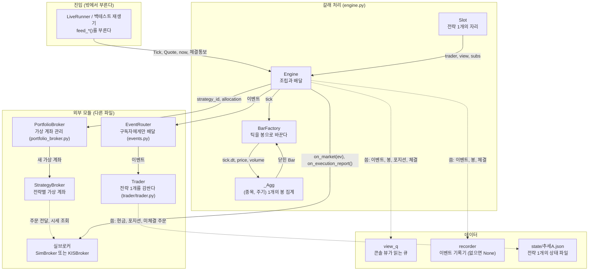
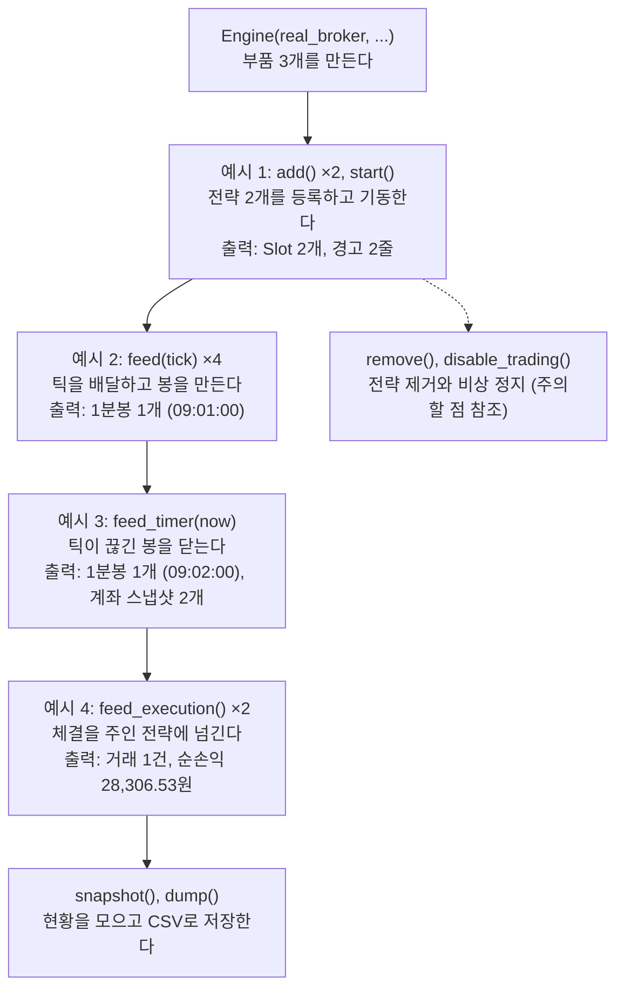
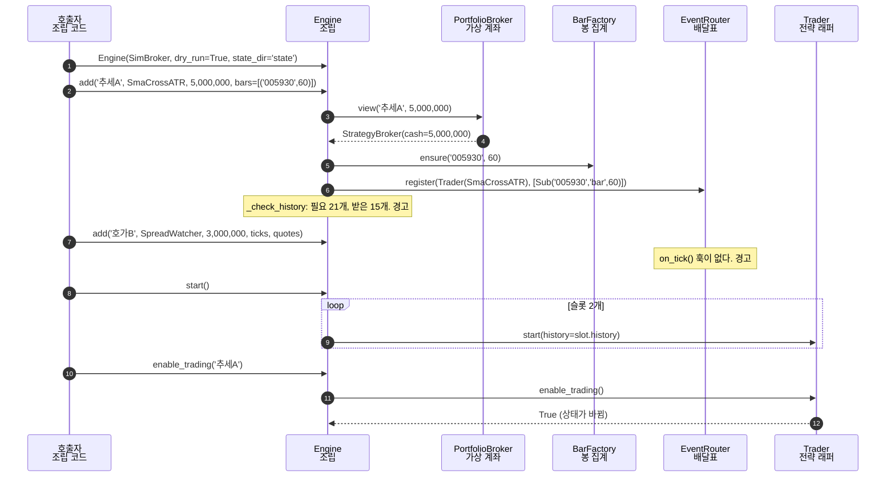
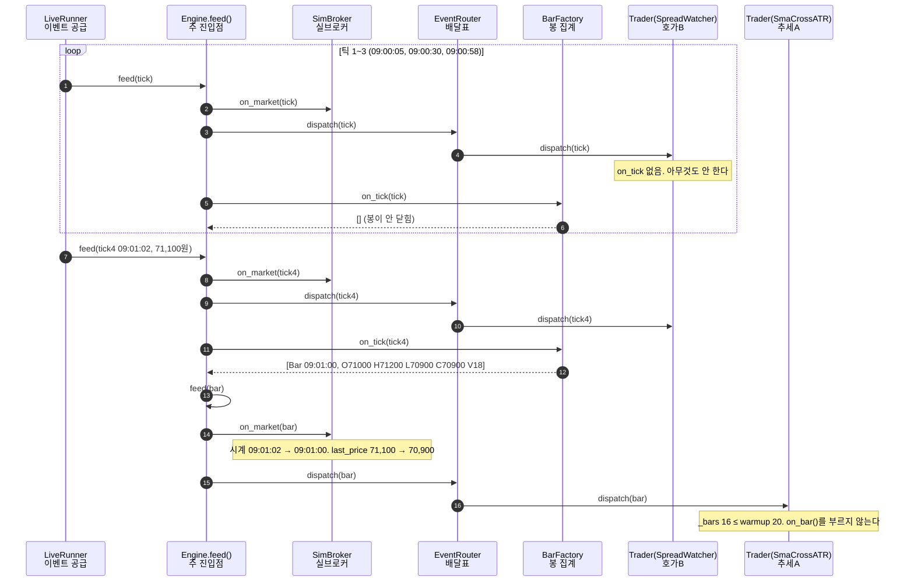
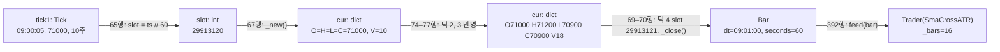
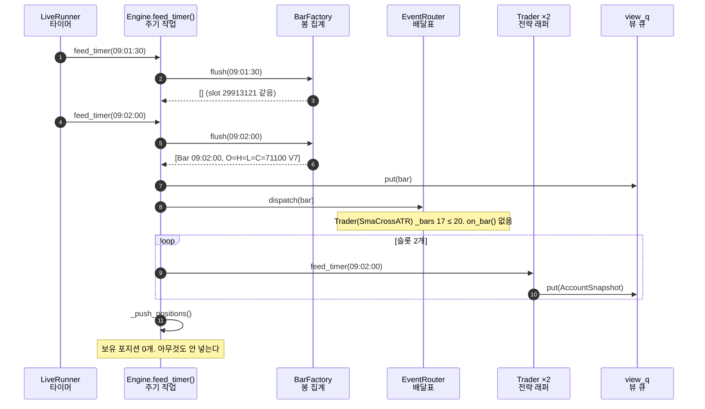
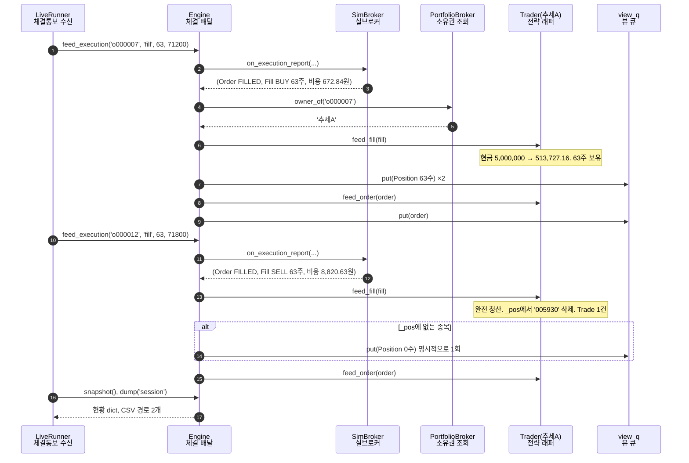
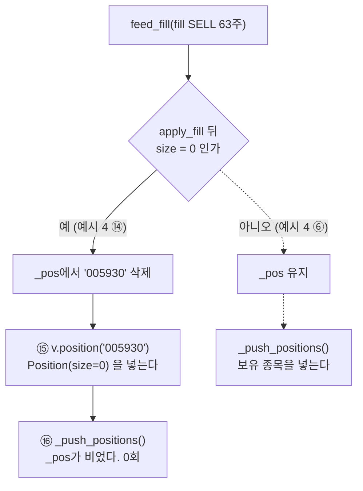

# engine.py 코드 설명서

이 문서는 `src/alpha/engine/engine.py`를 설명하는 자료이다.

- 모드: 스크립트 모드. 파일 전체(583행)를 설명한다.
- 작성 방법: 코드를 읽고 예시 값을 따라갔다. 대상 코드를 실행하지 않았다.
- 수치 출처: 독립 계산 스크립트 `index/work/N-001/calc.py`의 출력이다. 이 스크립트는 대상 코드를 import하지 않는다.
- "(추정)" 표시: 코드를 끝까지 따라가지 않은 값이다. 근거 줄 번호를 함께 쓴다.

---

## 1. 큰 틀: 구조도

`Engine`은 이벤트를 받는다. `Engine`은 이벤트를 구독한 `Trader`에게만 넘긴다.
`BarFactory`는 틱을 봉으로 만든다. `PortfolioBroker`는 계좌 1개를 전략별 가상 계좌로 나눈다.



읽는 법: 실선은 호출이다. 점선은 데이터 읽기나 쓰기다.

구성 요소 6개의 역할은 아래와 같다.

| 구성 요소 | 위치 | 하는 일 |
|---|---|---|
| `_Agg` | `engine.py:52-102` | (종목, 주기) 1개의 틱을 봉 1개로 모은다 |
| `BarFactory` | `engine.py:105-142` | `_Agg`를 (종목, 주기)마다 1개만 만든다. 전략끼리 공유한다 |
| `Slot` | `engine.py:149-156` | 전략 1개의 `Trader`, 가상 계좌, 구독 목록, 과거 이벤트를 묶는다 |
| `Engine` | `engine.py:159-583` | 전략을 등록한다. 이벤트와 체결을 주인 `Trader`에게 넘긴다 |
| `EventRouter` | `events.py:320-381` | (종목, 종류, 주기)를 키로 구독자 목록을 찾는다 |
| `PortfolioBroker` | `portfolio_broker.py:221-321` | 실브로커 1개를 전략별 `StrategyBroker`로 나눈다 |

`Engine`은 반복문을 돌지 않는다. 밖의 코드가 `feed_*()` 메서드를 부른다. 실전에서는 `LiveRunner`가 부른다. 백테스트에서는 재생기가 부른다 (`engine.py:162-165`).

---

## 2. 큰 흐름: 실행 순서 개요

`Engine`을 쓰는 순서는 4단계다. 조립 → 이벤트 투입 → 타이머 → 체결이다.



읽는 법: 상자 1개가 예시 1개다. 점선 상자는 예시가 지나가지 않는 코드다.

---

## 3. 예시 데이터

모든 예시는 2026-11-16의 삼성전자(종목 코드 `005930`) 거래 1일을 쓴다. 시각은 한국 시각(KST)이다.

### 3.1 파일 위치

```text
<작업 폴더>/
├─ state/
│   ├─ 추세A.json        ← Trader가 읽고 쓴다 (예시 1 ③, 예시 4 ⑦)
│   └─ 호가B.json        ← Trader가 쓴다 (stop() 때)
├─ session_fills.csv     ← dump()가 쓴다 (예시 4 ⑭)
└─ session_trades.csv    ← dump()가 쓴다 (예시 4 ⑭)
```

### 3.2 엔진 설정

모의 계좌 1개 위에 전략 2개를 올린다. 예시 1 ①이 이 데이터를 읽는다.

```jsonc
{
  "real_broker": "SimBroker(cash=10_000_000)", // 실브로커. 모의 계좌다. 증권사 API를 부르지 않는다
  "dry_run": true,                             // 처음에는 실주문을 막는다
  "state_dir": "state",                        // 상태 파일 폴더
  "recorder": null,                            // 기록기를 쓰지 않는다
  "view_q": "Queue()"                          // 콘솔 뷰가 읽는 큐 (추정: put()만 부른다, 383행)
}
```

### 3.3 전략 2개

예시 1 ②, ④가 이 데이터를 읽는다.

```jsonc
[
  {
    "strategy_id": "추세A",                      // 전략 이름. 상태 파일 이름이 된다
    "strategy": "SmaCrossATR(symbol='005930')", // 이동평균 교차 전략. 지표 4개 (SMA5, SMA20, CrossOver, ATR10)
    "allocation": 5000000,                      // 이 전략에 나눠 준 자본(원)
    "bars": [["005930", 60]],                   // 삼성전자 1분봉(60초)을 받는다
    "warmup": 20,                               // 실시간 봉 20개까지는 on_bar()를 부르지 않는다
    "history": "1분봉 15개 (08:45~08:59 종료)"   // 지표를 데울 과거 봉. 필요량은 21개다
  },
  {
    "strategy_id": "호가B",                      // 호가 관찰 전략. 주문을 내지 않는다
    "strategy": "SpreadWatcher()",              // on_quote()만 있다. on_tick()이 없다
    "allocation": 3000000,
    "ticks": ["005930"],                        // 틱을 받는다 (훅이 없어 경고가 나온다)
    "quotes": ["005930"]                        // 호가를 받는다
  }
]
```

용어:
- 틱(tick): 체결 1건이다. 가격과 수량이 있다.
- 봉(bar): 일정 시간 동안의 틱을 시가, 고가, 저가, 종가, 거래량 5개 값으로 묶은 것이다.
- 워밍업[^warmup]: 지표가 값을 내기 전에 과거 데이터를 넣는 일이다.

### 3.4 틱 4개

예시 2가 이 데이터를 읽는다. 마지막 틱이 1분 경계를 넘는다.

```jsonc
[
  {"kind": "tick", "symbol": "005930", "dt": "09:00:05", "price": 71000, "volume": 10}, // 09:00 봉의 첫 틱
  {"kind": "tick", "symbol": "005930", "dt": "09:00:30", "price": 71200, "volume": 5},  // 고가를 올린다
  {"kind": "tick", "symbol": "005930", "dt": "09:00:58", "price": 70900, "volume": 3},  // 저가를 내린다
  {"kind": "tick", "symbol": "005930", "dt": "09:01:02", "price": 71100, "volume": 7}   // 다음 분. 09:00 봉을 닫는다
]
```

### 3.5 체결통보 2건

예시 4가 이 데이터를 읽는다. `SimBroker`가 만든 통보를 `LiveRunner`가 넘긴다 (`live_runner.py:230-236`).

```jsonc
[
  {"broker_id": "o000007", "status": "fill", "filled_qty": 63, "price": 71200, "dt": "09:31:00"}, // 추세A 시장가 매수
  {"broker_id": "o000012", "status": "fill", "filled_qty": 63, "price": 71800, "dt": "10:15:00"}  // 추세A 전량 매도
]
```

- 주문 번호 `o000007`의 형식은 `Order.id`의 기본값 `f"o{next(_seq):06d}"`에서 왔다 (`core/orders.py:75`). 숫자 7, 12는 예시 값이다.
- 63주는 `target_pct(0.9)`가 낼 수량으로 정했다. 4,500,000원 ÷ 71,100원 = 63.29이다 (추정: `target_pct` 내부는 범위 밖, `sma_cross_atr.py:52`).

---

## 4. 예시 1: 조립과 기동

**상황**: 장 시작 전에 전략 2개를 등록한다. 그 다음에 엔진을 기동한다. 그 다음에 "추세A"만 실주문을 켠다.

```python
eng = Engine(SimBroker(fill_q, cash=10_000_000), dry_run=True, state_dir="state", view_q=q)
eng.add("추세A", SmaCrossATR(symbol="005930"), allocation=5_000_000,
        bars=[("005930", 60)], warmup=20, history=min1_bars_15)
eng.add("호가B", SpreadWatcher(), allocation=3_000_000, ticks=["005930"], quotes=["005930"])
eng.start()
eng.enable_trading("추세A")
```

### 시퀀스 다이어그램

`add()`는 가상 계좌, `Trader`, 구독 목록을 만든다. `start()`는 모든 `Trader`를 기동한다.



읽는 법: 번호는 아래 단계 번호와 같다. `Note`는 판단 결과다.

### ① `Engine.__init__()`: 부품 3개를 만든다

위치: `engine.py:168-191`

**이 단계에서 하는 일**
`Engine`이 가상 계좌 관리자, 배달표, 봉 집계기를 만든다. 인자 4개를 필드에 저장한다.

**들어가는 데이터**
```jsonc
{"real_broker": "SimBroker", "dry_run": true, "state_dir": "state", "recorder": null, "view_q": "Queue()"}
```

**코드와 주석**
```python
def __init__(self, real_broker: Broker, dry_run: bool = True,
             state_dir: str | None = None, recorder=None, view_q=None):
    self.portfolio = PortfolioBroker(real_broker)  # ← 실브로커를 감싼 가상 계좌 관리자
    self.router = EventRouter()                    # ← 빈 배달표
    self.bars = BarFactory()                       # ← 빈 봉 집계기 모음
    self.slots: dict[str, Slot] = {}               # ← 전략 id → Slot
    self.dry_run = dry_run                         # ← 새 Trader에 그대로 넘긴다
    self.state_dir = state_dir
    # … (176–177행 생략: 주석)
    self.recorder = recorder
    # … (179–182행 생략: 주석)
    self.view_q = view_q
    # … (184–186행 생략: 주석)
    self._started = False                          # ← start()가 끝나면 True
    # … (188–190행 생략: 주석)
    self.universe = None                           # ← 동적 유니버스 재계산기. 기본은 없음
```

**나오는 데이터**
```text
eng.slots = {}
eng.portfolio._views = {}
eng.bars._aggs = {}
eng._started = False
```

**다음 단계**: ② `add("추세A", ...)`가 이 빈 부품을 채운다.

### ②–⑤ `add("추세A", ...)`: 봉 전략 1개를 등록한다

위치: `engine.py:194-262`

**이 단계에서 하는 일**
`add()`가 가상 계좌를 만든다. `add()`가 그 계좌로 `Trader`를 만든다. 그 다음에 구독 목록을 배달표에 올린다.

**들어가는 데이터**
```jsonc
{"strategy_id": "추세A", "allocation": 5000000, "ticks": [], "quotes": [],
 "bars": [["005930", 60]], "warmup": 20, "history": "Bar 15개"}
```

**코드와 주석**
```python
view = self.portfolio.view(strategy_id, allocation)   # ← ② StrategyBroker('추세A', 5,000,000)
trader = Trader(broker=view, strategy=strategy, warmup=warmup,
                dry_run=self.dry_run,
                state_path=(f"{self.state_dir}/{strategy_id}.json"   # ← 'state/추세A.json'
                            if self.state_dir else None),
                strategy_id=strategy_id, recorder=self.recorder,
                view_q=self.view_q)

subs = [Subscription(s, "tick") for s in ticks]       # ← ticks=() 이므로 []
subs += [Subscription(s, "quote") for s in quotes]    # ← quotes=() 이므로 []
for sym, sec in bars:                                 # ← 1회: ('005930', 60)
    # … (235–237행 생략: 주석)
    subs.append(Subscription(sym, "bar", sec))        # ← 주기 60을 구독에 넣는다
    self.bars.ensure(sym, sec)                        # ← ③ _Agg('005930', 60)을 만든다
                                                      # [개념] setdefault: 키가 있으면 기존 값을 둔다

# … (241–243행 생략: 주석)
self.router.register(trader, subs)                    # ← ④ 배달표에 Trader를 올린다

slot = Slot(sid=strategy_id, trader=trader, view=view, subs=subs,
            history=list(history))                    # ← 튜플이어도 list로 복사한다
self.slots[strategy_id] = slot

# … (250–251행 생략: 주석)
self._check_history(strategy_id, strategy, slot.history)   # ← ⑤ 과거 이벤트 양 검사

# … (254–259행 생략: 주석)
if self._started:                                     # ← 지금은 False. 기동하지 않는다
    slot.trader.start(history=slot.history)
return slot
```

`Subscription`[^subscription]은 "어떤 종목의 어떤 종류를 받는가"를 적은 값이다. 배달표는 `EventRouter`[^router]다.

**값 추적**
1. ② `view` = `StrategyBroker(sid='추세A', allocation=5,000,000, _cash=5,000,000, _pos={})`
2. `trader.state_path` = `state/추세A.json`
3. `trader.broker`는 `GuardBroker`다. `enabled=False`, `dry_run=True`다 (`trader/trader.py:65`).
4. `subs` = `[Subscription('005930', 'bar', 60)]`
5. ③ `eng.bars._aggs` = `{('005930', 60): _Agg(cur=None)}`
6. ④ `register()`가 `trader.handles('bar')`를 부른다. `SmaCrossATR`는 `on_bar`를 덮어썼다. 그래서 `True`다 (`trader/trader.py:202-217`).
7. ④ `router._routes` = `{('005930','bar',60): [Trader(SmaCrossATR)]}`

**⑤ `_check_history()`: 과거 이벤트가 충분한지 센다**

위치: `engine.py:293-307`

```python
def _check_history(self, sid: str, strategy: Strategy, history: list):
    need = strategy.required_history()          # ← {('005930','bar',None): 21}
    if not need:                                # ← 비어 있지 않다. 계속한다
        return
    for key, n in need.items():                 # ← 1회
        sym, kind, variant = key                # ← '005930', 'bar', None
        # … (299행 생략: 주석)
        got = sum(1 for ev in history
                  if ev.kind == kind                                  # ← 15개 모두 'bar'
                  and (variant is None or ev.variant == variant)      # ← variant=None 이므로 주기를 묻지 않는다
                  and (sym is None or ev.symbol == sym))              # ← 15개 모두 '005930'
        if got < n:                                                   # ← 15 < 21
            log.warning("[%s] 워밍업 부족 — %s 가 %d개 필요한데 %d개 "
                        "(부족분은 실시간으로 채워질 때까지 대기)",
                        sid, key, n, got)
```

필요량 21의 계산 (`calc.py` 출력):

| 지표 | warmup | 근거 |
|---|---|---|
| SMA(5) | 5 | `period` 기본 규칙 (`indicators.py:154-160`) |
| SMA(20) | 20 | 같은 규칙 |
| CrossOver(SMA5, SMA20) | max(5, 20) + 1 = 21 | `indicators.py:411-416` |
| ATR(10) | 10 | `period` 기본 규칙 |
| **키별 최댓값** | **21** | `strategy/base.py:217-220` |

- 키의 `variant`는 `None`이다. `SmaCrossATR.setup()`이 `ind()`에 `variant`를 주지 않는다 (`sma_cross_atr.py:37-40`).
- 경고 1줄: `[추세A] 워밍업 부족 — ('005930', 'bar', None) 가 21개 필요한데 15개 (부족분은 실시간으로 채워질 때까지 대기)`
- 부족한 수: 21 − 15 = 6개

**나오는 데이터**
```text
eng.slots = {'추세A': Slot(sid='추세A', subs=[Sub('005930','bar',60)], history=[Bar ×15])}
로그 경고 1줄 (워밍업 부족)
```

**다음 단계**: 같은 `add()`가 "호가B"를 등록한다.

### ⑥–⑦ `add("호가B", ...)`: 틱·호가 전략 1개를 등록한다

위치: `engine.py:194-262` (② 단계와 같은 코드)

**이 단계에서 하는 일**
② 단계와 같은 코드를 지난다. 이번에는 `bars`가 비어 있다. 그래서 봉 집계기를 만들지 않는다.

**값 추적**
1. `view` = `StrategyBroker(sid='호가B', allocation=3,000,000, _cash=3,000,000)`
2. `subs` = `[Subscription('005930','tick'), Subscription('005930','quote')]`
3. `for sym, sec in bars` 반복은 0회다. `eng.bars._aggs`는 1개 그대로다.
4. ⑦ `register()`가 `handles('tick')`을 부른다. `SpreadWatcher`에는 `on_tick`이 없다. `Strategy` 기본 클래스에도 없다. 그래서 `False`다.
5. ⑦ 경고 1줄: `Trader(SpreadWatcher) 가 'tick' 를 구독했지만 on_tick() 훅이 없다 — 오타?` (`events.py:352-354`)
6. `handles('quote')`는 `True`다. 경고가 없다.
7. 경고가 나와도 구독은 배달표에 올라간다 (`events.py:355-356`).
8. `_check_history()`에서 `need = {}`다. 지표가 없기 때문이다. 296행에서 끝난다.

**나오는 데이터**
```text
router._routes = {
  ('005930','bar',60):    [Trader(SmaCrossATR)],
  ('005930','tick',None): [Trader(SpreadWatcher)],
  ('005930','quote',None):[Trader(SpreadWatcher)],
}
eng.slots 키 = ['추세A', '호가B']
```

**다음 단계**: ⑧ `start()`가 두 슬롯을 기동한다.

### ⑧–⑨ `start()`: 모든 전략을 기동한다

위치: `engine.py:309-321`

**이 단계에서 하는 일**
`start()`가 슬롯마다 `Trader.start()`를 부른다. `Trader.start()`는 과거 이벤트로 지표를 데운다. 그 다음에 상태 파일을 읽는다.

**코드와 주석**
```python
def start(self, history: dict[str, list] | None = None):
    override = history or {}                        # ← history=None 이므로 {}
    for sid, slot in self.slots.items():            # ← '추세A', '호가B' 순서
        slot.trader.start(history=override.get(sid, slot.history))   # ← override가 비어 slot.history를 쓴다
    self._started = True                            # ← 이 뒤의 add()는 즉시 기동한다
    log.info("엔진 기동 — 전략 %d개, dry_run=%s", len(self.slots), self.dry_run)
```

**값 추적 (반복 회차)**

| 회차 | sid | history | Trader.start() 뒤 `_bars` | 상태 파일 |
|---|---|---|---|---|
| 1 | 추세A | Bar 15개 | 15 | `state/추세A.json`이 있으면 읽는다 |
| 2 | 호가B | [] | 0 | `state/호가B.json`이 있으면 읽는다 |

- 이 예시에서는 상태 파일이 없다고 정한다. 그래서 두 계좌의 현금은 배정 자본 그대로다.
- `Trader.start()`는 과거 이벤트에 전략 훅을 부르지 않는다. 과거 신호로 주문이 나가지 않는다 (`trader/trader.py:101-105`).
- 로그 1줄: `엔진 기동 — 전략 2개, dry_run=True`

### ⑩–⑪ `enable_trading("추세A")`: 전략 1개의 실주문을 켠다

위치: `engine.py:327-335`, `engine.py:354-361`

**코드와 주석**
```python
def enable_trading(self, strategy_id: str | None = None) -> bool:
    changed = False
    for s in self._targets(strategy_id):          # ← [Slot('추세A')]
        changed |= s.trader.enable_trading()       # ← dry_run True→False. True를 돌려준다
    return changed                                 # ← True

def _targets(self, strategy_id: str | None):
    if strategy_id is None:                        # ← None이면 모든 슬롯
        return list(self.slots.values())
    slot = self.slots.get(strategy_id)             # ← Slot('추세A')
    if slot is None:                               # ← 모르는 id면 경고하고 []
        log.warning("모르는 전략 id: %s", strategy_id)
        return []
    return [slot]
```

`enable_trading()`은 멱등[^idempotent]이다. 두 번째 호출은 `False`를 돌려준다.

**나오는 데이터**
```text
enable_trading('추세A') → True
trading_status() → {'추세A': True, '호가B': False}
```

### 예시 1 결과

- 출력: `Slot` 2개, `_Agg` 1개, 배달표 키 3개
- 부수효과: 경고 로그 2줄, 정보 로그 1줄
- "추세A"는 실주문이 켜졌다. 그러나 워밍업이 끝나기 전에는 `on_bar()`가 불리지 않는다.

---

## 5. 예시 2: 틱 4개로 1분봉 1개를 만든다

**상황**: 장이 열린다. 삼성전자 틱 4개가 차례로 들어온다. 입력: 3.4절의 틱 4개.

```python
for tick in [t1, t2, t3, t4]:
    eng.feed(tick)
```

### 시퀀스 다이어그램

틱 1~3은 봉을 닫지 않는다. 틱 4가 다음 분에 들어온다. 그래서 09:00 봉이 닫힌다.



읽는 법: `loop` 안의 ①–⑦은 틱 3개에 똑같이 일어난다. ⑧ 이후는 틱 4에서만 일어난다.

### 데이터 변환도

틱이 집계 딕셔너리가 된다. 슬롯이 바뀌면 딕셔너리가 `Bar`가 된다.



읽는 법: 상자는 데이터 1개다. 선의 글자는 데이터를 바꾸는 줄 번호다.

### ①–④ `feed(tick)`: 틱 1개를 처리한다

위치: `engine.py:364-392`

**이 단계에서 하는 일**
`feed()`는 이벤트 1개를 4곳에 넘긴다. 순서는 뷰 큐, 실브로커, 배달표, 봉 집계기다.

**들어가는 데이터 (틱 1)**
```jsonc
{"kind": "tick", "symbol": "005930", "dt": "2026-11-16 09:00:05", "price": 71000, "volume": 10}
```

**코드와 주석**
```python
def feed(self, ev: MarketEvent):
    # … (365–381행 생략: 문서 문자열)
    if self.view_q is not None:
        self.view_q.put(ev)               # ← ① 뷰 큐에 틱을 넣는다
    if self.recorder is not None:         # ← recorder=None. 건너뛴다
        self.recorder.put(ev)

    self.portfolio.real.on_market(ev)    # ← ② SimBroker 시계와 현재가를 바꾼다
    self.router.dispatch(ev)             # ← ③ 틱 구독자에게 배달한다

    if ev.kind == "tick":                # ← 'tick' 이므로 들어간다
        for bar in self.bars.on_tick(ev):   # ← ④ 닫힌 봉 목록. 틱 1~3에서는 []
            self.feed(bar)               # ← 닫힌 봉을 같은 경로로 다시 넣는다
                                         # [개념] 재귀 호출: 함수가 자기 자신을 부른다. 봉은 'tick'이 아니므로 1단계에서 멈춘다
```

**값 추적 (② 실브로커)**
1. `SimBroker.on_market(tick1)`이 `_now = 09:00:05`로 바꾼다 (`sim_broker.py:191`).
2. `tick1.ref_price` = 71,000이다. 그래서 `005930`의 `last_price` = 71,000이다 (`sim_broker.py:195-196`).
3. 대기 주문이 없다. `_match()`는 아무것도 하지 않는다.

**값 추적 (③ 배달)**
1. `targets(tick1)`이 키 `('005930','tick',None)`을 찾는다 (`events.py:371-377`).
2. 결과는 `[Trader(SpreadWatcher)]`다. 와일드카드 키 `('*','tick',None)`은 없다.
3. `Trader.dispatch()`가 지표를 갱신한다. "호가B"에는 지표가 없다.
4. `ev.kind`가 `'bar'`가 아니다. 그래서 봉 카운터를 세지 않는다.
5. `strategy.ready`는 `all([])` = `True`다.
6. `getattr(strategy, 'on_tick', None)`은 `None`이다. 그래서 훅을 부르지 않는다 (`trader/trader.py:194-196`).
7. "추세A"는 틱을 받지 않는다. 배달표에 키가 없기 때문이다.

**다음 단계**: ④ `BarFactory.on_tick()`이 같은 틱을 받는다.

### ④ `BarFactory.on_tick()`과 `_Agg.on_tick()`: 틱을 봉에 더한다

위치: `engine.py:124-133`, `engine.py:64-78`, `engine.py:92-102`

**이 단계에서 하는 일**
`BarFactory`는 틱의 종목과 같은 집계기를 모두 찾는다. 집계기는 틱의 시각을 슬롯[^slot]으로 바꾼다. 슬롯이 바뀌면 집계기가 봉을 닫는다.

**코드와 주석**
```python
def on_tick(self, tick: Tick) -> list[Bar]:              # BarFactory
    out = []
    for (sym, _), agg in self._aggs.items():             # ← 1회: ('005930', 60)
        if sym != tick.symbol:                           # ← 같은 종목. 계속한다
            continue
        bar = agg.on_tick(tick.dt, tick.price, tick.volume)
        if bar is not None:
            out.append(bar)
    return out

def on_tick(self, dt, price, volume) -> Optional[Bar]:   # _Agg
    slot = int(dt.timestamp()) // self.seconds           # ← 유닉스 초 ÷ 60의 몫
                                                         # [개념] timestamp(): 1970-01-01 UTC부터 지난 초
    if self.cur is None:                                 # ← 틱 1: 첫 봉
        self.cur = self._new(slot, price, volume)
        return None
    if slot != self.cur["slot"]:                         # ← 틱 4: 슬롯이 바뀌었다
        done = self._close(self.cur)                     # ← 이전 봉을 Bar로 닫는다
        self.cur = self._new(slot, price, volume)        # ← 새 봉을 연다
        return done
    c = self.cur                                         # ← 틱 2, 3: 같은 슬롯
    c["high"] = max(c["high"], price)
    c["low"] = min(c["low"], price)
    c["close"] = price                  # 마지막 틱 가격이 종가
    c["volume"] += volume
    return None

def _new(self, slot, price, volume):
    return dict(slot=slot, open=price, high=price,       # ← 첫 틱 가격이 시가, 고가, 저가, 종가
                low=price, close=price, volume=volume)

def _close(self, c) -> Bar:
    end = datetime.fromtimestamp((c["slot"] + 1) * self.seconds)   # ← 봉이 끝난 시각
    return Bar(kind="bar", symbol=self.symbol, dt=end,
               open=c["open"], high=c["high"], low=c["low"],
               close=c["close"], volume=c["volume"], seconds=self.seconds)
```

**값 추적 (반복 회차, `calc.py` 출력)**

| 틱 | 시각 | 유닉스 초 | slot | 갈래 | 처리 뒤 `cur` |
|---|---|---|---|---|---|
| 1 | 09:00:05 | 1794787205 | 29913120 | 새 봉 (66행) | O71000 H71000 L71000 C71000 V10 |
| 2 | 09:00:30 | 1794787230 | 29913120 | 갱신 (73행) | O71000 H71200 L71000 C71200 V15 |
| 3 | 09:00:58 | 1794787258 | 29913120 | 갱신 (73행) | O71000 H71200 L70900 C70900 V18 |
| 4 | 09:01:02 | 1794787262 | 29913121 | 닫기 (69행) | O=H=L=C=71100 V7 (새 봉) |

`_close()` 전과 후 (틱 4):

| 바뀌기 전: `cur` (dict) | 바뀐 뒤: `Bar` |
|---|---|
| `slot=29913120` | `dt=09:01:00` ((29913120+1)×60초) |
| `open=71000, high=71200` | `open=71000, high=71200` |
| `low=70900, close=70900` | `low=70900, close=70900` |
| `volume=18` | `volume=18, seconds=60, symbol='005930'` |

**나오는 데이터**
```text
틱 1~3: []
틱 4:  [Bar(kind='bar', symbol='005930', dt=09:01:00, open=71000, high=71200, low=70900, close=70900, volume=18, seconds=60)]
```

**다음 단계**: ⑫ `feed(bar)`가 이 봉을 받는다.

### ⑧–⑪ `feed(tick4)`: 틱 4를 배달한다

위치: `engine.py:382-391`

①–④ 단계와 같은 코드를 지난다. 값만 다르다.
- `SimBroker._now` = 09:01:02. `last_price` = 71,100.
- `Trader(SpreadWatcher)`는 아무것도 하지 않는다.
- `BarFactory.on_tick()`이 `Bar` 1개를 돌려준다.

### ⑫–⑮ `feed(bar)`: 닫힌 봉을 같은 경로로 배달한다

위치: `engine.py:392` → `engine.py:382-390`

**이 단계에서 하는 일**
`feed()`가 봉으로 자기 자신을 다시 부른다. 봉도 뷰 큐, 실브로커, 배달표를 지난다. 봉은 틱이 아니므로 390행에서 끝난다.

**들어가는 데이터**
```text
Bar(symbol='005930', dt=09:01:00, open=71000, high=71200, low=70900, close=70900, volume=18, seconds=60)
```

**값 추적**
1. ⑫ `view_q.put(bar)`: 뷰 큐에 봉이 들어간다.
2. ⑬ `SimBroker.on_market(bar)`: `_now` = 09:01:00이다. 시계가 09:01:02에서 2초 뒤로 간다.
3. ⑬ `bar.ref_price` = `close` = 70,900이다. 그래서 `last_price`가 71,100에서 70,900으로 바뀐다 (`events.py:243`).
4. ⑭ `targets(bar)`: `bar.variant` = `seconds` = 60이다 (`events.py:237-241`). 키 `('005930','bar',60)`에서 `[Trader(SmaCrossATR)]`를 찾는다.
5. ⑮ `Trader.dispatch(bar)`: 지표 4개를 갱신한다. 그 다음에 지표 값을 `IndicatorSnapshot`으로 뷰 큐에 넣는다 (`trader/trader.py:178`, `trader/trader.py:298-299`). 지표마다 라인 1개는 추정이다 (`strategy/base.py:191-194`).
6. ⑮ `_bars` = 15 + 1 = 16이다. 16 ≤ 20이므로 `on_bar()`를 부르지 않는다 (`trader/trader.py:184-187`).
7. `bar.kind`는 `'bar'`다. 그래서 `feed(bar)`는 390행 조건을 지나지 않는다.

**나오는 데이터**
```text
view_q에 들어간 것: Tick ×4, Bar ×1, IndicatorSnapshot ×4 (추정)
trader(추세A)._bars = 16
SimBroker: _now = 09:01:00, last_price('005930') = 70900
```

### 예시 2 결과

- 출력: 1분봉 1개 (09:01:00 종료, 시가 71,000, 고가 71,200, 저가 70,900, 종가 70,900, 거래량 18)
- 열린 봉: 09:01 슬롯, 71,100원, 7주
- 부수효과: 실브로커의 시계와 현재가가 봉 값으로 바뀐다. 주의할 점 3번을 읽는다.

---

## 6. 예시 3: 틱이 끊긴 봉을 타이머로 닫는다

**상황**: 09:01:02 뒤로 삼성전자 틱이 오지 않는다. `LiveRunner`가 1초마다 `feed_timer(now)`를 부른다. 입력: `now` = 09:01:30, 그리고 `now` = 09:02:00.

### 시퀀스 다이어그램

09:01:30에는 슬롯이 같다. 09:02:00에는 슬롯이 바뀐다. 그래서 09:01 봉이 닫힌다.



읽는 법: ①–③은 09:01:30 호출이다. ④ 이후는 09:02:00 호출이다.

### ①–⑥ `feed_timer(now)`와 `flush(now)`: 시간이 지난 봉을 닫는다

위치: `engine.py:394-418`, `engine.py:135-142`, `engine.py:80-90`

**이 단계에서 하는 일**
`feed_timer()`가 먼저 `BarFactory.flush()`를 부른다. `flush()`는 `now`의 슬롯과 열린 봉의 슬롯을 비교한다. 두 슬롯이 다르면 `flush()`가 봉을 닫는다.

**들어가는 데이터**
```text
now = 2026-11-16 09:02:00
_Agg('005930', 60).cur = {slot: 29913121, open: 71100, high: 71100, low: 71100, close: 71100, volume: 7}
```

**코드와 주석**
```python
def feed_timer(self, now: datetime):
    # … (395–407행 생략: 문서 문자열)
    for bar in self.bars.flush(now):        # ← ④ [Bar 09:02:00]
        if self.recorder is not None:       # ← None. 건너뛴다
            self.recorder.put(bar)
        if self.view_q is not None:
            self.view_q.put(bar)            # ← ⑤ 뷰 큐에 봉을 넣는다
        self.router.dispatch(bar)           # ← ⑥ 봉 구독자에게 배달한다
                                            #   on_market()을 부르지 않는다
    for slot in self.slots.values():
        slot.trader.feed_timer(now)         # ← ⑦ 전략별 타이머
    self._push_positions()                  # ← ⑧ 포지션판 갱신
    if self.universe is not None:           # ← None. 건너뛴다
        self.universe.maybe_rebalance(now)

def flush(self, now: datetime) -> Optional[Bar]:          # _Agg
    if self.cur is None:                                  # ← 열린 봉이 없으면 None
        return None
    if int(now.timestamp()) // self.seconds != self.cur["slot"]:   # ← 29913122 != 29913121
        done, self.cur = self._close(self.cur), None      # ← 봉을 닫고 cur를 비운다
        return done
    return None
```

**값 추적 (`calc.py` 출력)**

| 호출 | now | now의 slot | cur의 slot | 닫는가 |
|---|---|---|---|---|
| ①–③ | 09:01:30 | 29913121 | 29913121 | 아니오 |
| ④–⑥ | 09:02:00 | 29913122 | 29913121 | 예 |

1. ④ 닫힌 봉: `Bar(dt=09:02:00, open=71100, high=71100, low=71100, close=71100, volume=7, seconds=60)`
2. ④ `_Agg.cur` = `None`. 다음 틱이 새 봉을 연다.
3. ⑥ `Trader(SmaCrossATR)._bars` = 17이다. 17 ≤ 20이므로 `on_bar()`를 부르지 않는다.

**다음 단계**: ⑦ `Trader.feed_timer()`가 같은 `now`를 받는다.

### ⑦–⑧ `Trader.feed_timer()`와 `_push_positions()`

위치: `engine.py:414-416`, `engine.py:450-476`, `trader/trader.py:254-271`

**이 단계에서 하는 일**
`Trader.feed_timer()`는 계좌 스냅샷을 뷰 큐에 넣는다. 그 다음에 전략의 `on_timer()`를 부른다. `_push_positions()`는 보유 포지션을 뷰 큐에 넣는다.

**코드와 주석**
```python
def _push_positions(self):
    # … (451–469행 생략: 문서 문자열)
    if self.view_q is None:                         # ← view_q가 있다. 계속한다
        return
    for v in self.portfolio._views.values():        # ← StrategyBroker('추세A'), ('호가B')
        for symbol in v._pos:                       # ← 두 계좌 모두 _pos = {}. 0회
            pos = v.position(symbol)                # ← 실브로커의 last_price를 합친 새 Position
            pos.strategy_id = v.sid                 # 기록/조회용 — v.position()은 이걸 모른다
            self.view_q.put(pos)
```

**값 추적 (반복 회차)**

| 회차 | Trader | 뷰 큐에 넣는 것 | cash | equity |
|---|---|---|---|---|
| 1 | 추세A | `AccountSnapshot` | 5,000,000 | 5,000,000 |
| 2 | 호가B | `AccountSnapshot` | 3,000,000 | 3,000,000 |

- 보유 종목이 없다. 그래서 `equity`는 `cash`와 같다 (`portfolio_broker.py:94-101`).
- `_push_positions()`는 아무것도 넣지 않는다. 두 `_pos`가 비어 있기 때문이다.

### 예시 3 결과

- 출력: 1분봉 1개 (09:02:00 종료, 71,100원, 7주)
- 뷰 큐: `Bar` ×1, `AccountSnapshot` ×2
- "추세A"의 `_bars` = 17. 실시간 봉 3개가 더 오면 `_bars`가 20을 넘는다. 21번째 봉부터 `on_bar()`가 불린다.

---

## 7. 예시 4: 체결을 주인 전략에 넘긴다

**상황**: 워밍업이 끝났다. "추세A"가 09:31에 시장가로 63주를 샀다. 10:15에 63주를 모두 팔았다. 입력: 3.5절의 체결통보 2건.

```python
eng.feed_execution(broker_id="o000007", status="fill", filled_qty=63, price=71200, dt=t_0931)
eng.feed_execution(broker_id="o000012", status="fill", filled_qty=63, price=71800, dt=t_1015)
eng.snapshot()
eng.dump("session")
```

### 시퀀스 다이어그램

체결통보는 실브로커가 먼저 처리한다. 그 다음에 `Engine`이 주문 번호로 주인 전략을 찾는다.



읽는 법: ①–⑪은 매수 체결이다. ⑫ 이후는 매도 체결과 현황 조회다.

### ①–③ `feed_execution()`: 체결통보를 실브로커에 넣는다

위치: `engine.py:492-518`

**이 단계에서 하는 일**
`feed_execution()`이 통보를 실브로커에 넘긴다. 실브로커는 증권사 주문 번호를 우리 `Order`로 되돌린다. 실브로커가 돌려준 `fill`과 `order`를 차례로 배달한다.

**들어가는 데이터**
```jsonc
{"broker_id": "o000007", "status": "fill", "filled_qty": 63, "price": 71200, "dt": "2026-11-16 09:31:00"}
```

**코드와 주석**
```python
def feed_execution(self, broker_id: str, status: str,
                   filled_qty: float, price: float, dt: datetime):
    # … (494–509행 생략: 문서 문자열)
    order, fill = self.portfolio.real.on_execution_report(
        broker_id=broker_id, status=status,
        filled_qty=filled_qty, price=price, dt=dt)   # ← ② SimBroker가 계좌를 갱신한다

    if order is None:
        return                          # 수동주문이거나 재시작 이전 주문
    if fill is not None:
        self.feed_fill(fill)            # ← ④ 체결을 먼저 배달한다
    self.feed_order(order)              # ← ⑩ 주문 상태를 나중에 배달한다
```

**값 추적 (② `SimBroker.on_execution_report()`, `sim_broker.py:274-332`)**
1. `_orders['o000007']`에서 주문을 찾는다. `status`가 `'reject'`가 아니다.
2. `size` = min(63, 남은 수량 63) = 63
3. 체결 금액 = 63 × 71,200 = 4,485,600원
4. 비용 = 4,485,600 × 0.00015 = 672.84원. 매수이므로 세금이 없다.

**나오는 데이터**
```text
order = Order(id='o000007', side=BUY, size=63, status=FILLED)   (추정: FILLED, order.apply_fill() 결과, sim_broker.py:327, core/orders.py:103, 118-119)
fill  = Fill(dt=09:31:00, symbol='005930', side=BUY, size=63, price=71200, order_id='o000007', commission=672.84)
```

**다음 단계**: ④ `feed_fill(fill)`이 이 `fill`을 받는다.

### ④–⑨ `feed_fill()`: 체결을 주인 전략에 넘긴다

위치: `engine.py:420-448`

**이 단계에서 하는 일**
`feed_fill()`이 주문 번호로 주인 전략을 찾는다. 그 전략의 `Trader`에 체결을 넘긴다. 그 다음에 포지션을 뷰 큐에 넣는다.

**코드와 주석**
```python
def feed_fill(self, fill: Fill):
    # … (421–425행 생략: 문서 문자열)
    sid = self.portfolio.owner_of(fill.order_id)    # ← ④ '추세A'
    if sid is None:
        return                                   # 주인 없는 체결 (수동주문 등)
    self.slots[sid].trader.feed_fill(fill)      # ← ⑥ 가상 계좌와 거래 기록을 갱신한다
    if self.recorder is not None:                # ← None. 건너뛴다
        self.recorder.put(fill)
    if self.view_q is not None:
        self.view_q.put(fill)                    # ← 뷰 큐에 체결을 넣는다
        # … (434–442행 생략: 완전 청산 주석)
        v = self.portfolio._views.get(sid)       # ← StrategyBroker('추세A')
        if v is not None:
            pos = v.position(fill.symbol)        # ← ⑧ _pos에 없어도 size=0인 Position을 만든다
            pos.strategy_id = sid
            self.view_q.put(pos)
    self._push_positions()                       # ← ⑨ 보유 중인 포지션 전부
```

**값 추적 (④–⑤ `owner_of()`, `portfolio_broker.py:255-281`)**
1. `_owner` 캐시에 `'o000007'`이 없다. `StrategyBroker.submit()`은 `_owner`에 쓰지 않기 때문이다.
2. 뷰를 차례로 묻는다. `StrategyBroker('추세A').owns('o000007')`가 `True`다.
3. `_owner['o000007']` = `'추세A'`를 캐시에 쓴다. `'추세A'`를 돌려준다.

**값 추적 (⑥–⑦ `Trader.feed_fill()`, `trader/trader.py:225-252`)**

| 항목 | 바뀌기 전 | 바뀐 뒤 | 계산 (`calc.py`) |
|---|---|---|---|
| `_pos['005930'].size` | 없음 | 63 | 0 + 63 |
| `_pos['005930'].avg_price` | 없음 | 71,200 | 신규 진입이므로 체결가 |
| `_cash` | 5,000,000 | 513,727.16 | 5,000,000 − 4,485,600 − 672.84 |
| `tracker._open` | {} | {'005930': 진입 63주} | 신규 진입. `Trade`는 없다 |

**값 추적 (⑧–⑨ 뷰 큐)**
1. ⑧ `v.position('005930')` = `Position(size=63, avg_price=71200, last_price=71200, strategy_id='추세A')`. 이 예시는 그때 현재가를 71,200원으로 정한다.
2. ⑨ `_push_positions()`가 같은 종목을 1번 더 넣는다. 뷰는 종목별 마지막 값만 보여 준다. 그래서 중복은 문제가 없다 (`engine.py:467-469`).

**나오는 데이터**
```text
view_q: Fill ×1, Position(63주) ×2
StrategyBroker('추세A'): cash=513727.16, equity=4999327.16 (현재가 71,200원 기준)
```

**다음 단계**: ⑩ `feed_order(order)`가 같은 주문을 받는다.

### ⑩–⑪ `feed_order()`: 주문 상태를 주인 전략에 알린다

위치: `engine.py:478-490`

**코드와 주석**
```python
def feed_order(self, order: Order):
    sid = self.portfolio.owner_of(order.id)     # ← 캐시에서 '추세A'를 바로 찾는다
    if sid is None:
        return
    self.slots[sid].trader.feed_order(order)    # ← on_order() 호출. 끝난 주문이면 상태 파일 저장
    if self.view_q is not None:
        # … (485–489행 생략: 주석)
        self.view_q.put(order)                  # ← ⑪ 끝난 주문도 뷰 큐에 넣는다
```

**값 추적**
1. `Trader.feed_order()`가 `SmaCrossATR.on_order()`를 부른다. 로그 `체결 buy 63주 @71,200`이 나온다 (`sma_cross_atr.py:65-67`).
2. `order.is_done`이 `True`다. 그래서 `Trader._save()`가 `state/추세A.json`을 쓴다 (`trader/trader.py:219-223`).
3. 상태 파일 내용: `{"broker": {"cash": 513727.16, "positions": {"005930": {"size": 63, "avg_price": 71200}}, "live_orders": []}, ...}`

### ⑫–⑯ 두 번째 `feed_execution()`: 전량 매도와 완전 청산

위치: `engine.py:492-518`, `engine.py:420-448` (①–⑪과 같은 코드)

**이 단계에서 하는 일**
①–⑪과 같은 코드를 지난다. 이번에는 체결 뒤 보유 수량이 0이다. 그래서 `_push_positions()`가 이 종목을 보지 못한다. ⑮의 명시적 넣기가 0주를 뷰에 알린다.

**들어가는 데이터**
```jsonc
{"broker_id": "o000012", "status": "fill", "filled_qty": 63, "price": 71800, "dt": "2026-11-16 10:15:00"}
```

**값 추적 (`calc.py` 출력)**
1. ⑬ 체결 금액 = 63 × 71,800 = 4,523,400원
2. ⑬ 비용 = 4,523,400 × (0.00015 + 0.0018) = 8,820.63원. 매도이므로 세금 0.18%를 더한다.
3. ⑭ `apply_fill()`: 63 − 63 = 0이다. `_pos`에서 `'005930'`을 지운다 (`portfolio_broker.py:159-161`).
4. ⑭ `_cash` = 513,727.16 + 4,523,400 − 8,820.63 = 5,028,306.53
5. ⑭ `TradeTracker`가 `Trade` 1건을 만든다. `on_trade()`를 부른다. 뷰 큐에 `Trade`를 넣는다. 상태 파일을 쓴다.

`Trade` 값 (`core/trades.py:188-236`, `calc.py` 출력):

| 항목 | 값 | 계산 |
|---|---|---|
| `gross_pnl` | 37,800 | (71,800 − 71,200) × 63 |
| `commission` | 9,493.47 | 672.84 + 8,820.63 × 1.0 |
| `pnl` | 28,306.53 | 37,800 − 9,493.47 |
| `exit_price` | 71,800 | 4,523,400 ÷ 63 |

검산: 5,000,000 + 28,306.53 = 5,028,306.53이다. 이 값은 4번의 `_cash`와 같다.

**완전 청산 갈래**



읽는 법: 실선이 이번 단계 경로다. 점선은 ⑥ 매수 때 지난 경로다.

**나오는 데이터**
```text
view_q: Fill ×1, Trade ×1, Position(size=0, strategy_id='추세A') ×1, Order ×1
StrategyBroker('추세A'): cash=5028306.53, _pos={}
```

### ⑰ `snapshot()`: 전략별 현황을 모은다

위치: `engine.py:521-528`, `portfolio_broker.py:310-321`

**코드와 주석**
```python
def snapshot(self) -> dict:
    snap = self.portfolio.snapshot()                # ← 가상 계좌별 현황 dict
    for sid, s in snap.items():                     # ← '추세A', '호가B'
        t = self.slots[sid].trader.tracker          # ← slots에 sid가 없으면 KeyError
        s["trades"] = len(t.closed)                 # ← 끝난 거래 수
        s["realized_pnl"] = t.realized_pnl          # ← 순손익 누적
    return snap
```

**나오는 데이터 (`calc.py` 출력)**
```jsonc
{
  "추세A": {"allocation": 5000000, "cash": 5028306.53, "equity": 5028306.53,
            "pnl_pct": 0.00566131,          // 5,028,306.53 ÷ 5,000,000 − 1 = 약 0.566%
            "positions": {}, "open_orders": 0,
            "trades": 1, "realized_pnl": 28306.53},
  "호가B": {"allocation": 3000000, "cash": 3000000, "equity": 3000000,
            "pnl_pct": 0.0, "positions": {}, "open_orders": 0,
            "trades": 0, "realized_pnl": 0.0}
}
```

### ⑱ `fill_records()`, `trade_records()`, `dump()`: 체결과 거래를 CSV로 저장한다

위치: `engine.py:535-583`

**코드와 주석**
```python
def fill_records(self) -> list[dict]:
    rows = []
    for sid, slot in self.slots.items():
        rows.extend(slot.trader.tracker.fill_records(sid))   # ← strategy_id 열을 붙인다
    rows.sort(key=lambda r: r["datetime"])     # 전략 간 시간순 정렬
    return rows

def trade_records(self) -> list[dict]:
    rows = []
    for sid, slot in self.slots.items():
        rows.extend(slot.trader.tracker.trade_records(sid))
    rows.sort(key=lambda r: r["exit_dt"] or r["entry_dt"])   # ← 청산 시각. 없으면 진입 시각
    return rows

def dump(self, prefix: str = "session"):
    import pandas as pd                        # ← pandas가 없으면 ImportError
    out = []
    for name, rows in (("fills", self.fill_records()),
                       ("trades", self.trade_records())):
        if not rows:                           # ← 행이 0개면 파일을 만들지 않는다
            continue
        path = f"{prefix}_{name}.csv"          # ← 'session_fills.csv'
        pd.DataFrame(rows).to_csv(path, index=False, encoding="utf-8-sig")
        out.append(path)
        log.info("%s %d행 저장 → %s", name, len(rows), path)
    return out
```

`fills_df()`와 `trades_df()`(558–566행)는 같은 행 목록을 `DataFrame`으로 바꾼다. 파일을 쓰지 않는다.

**값 추적**

| 파일 | 행 수 | 1행 요약 |
|---|---|---|
| `session_fills.csv` | 2 | 09:31:00, 005930, buy, 63, 71200, fillvalue 4485600, commission 672.84, o000007, 추세A |
| `session_trades.csv` | 1 | 09:31:00 → 10:15:00, long, 63주, 71200 → 71800, pnl 28306.53, 추세A |

**나오는 데이터**
```text
['session_fills.csv', 'session_trades.csv']
```

### 예시 4 결과

- 출력: `Trade` 1건 (순손익 28,306.53원), 현황 dict 1개, CSV 2개
- 부수효과: `state/추세A.json`을 4번 쓴다. 주문 종료 2번, 거래 완결 1번, 그리고 `stop()` 때 1번이다. `stop()`은 이 예시 밖이다.
- "호가B"의 가상 계좌는 바뀌지 않는다. 체결이 "추세A"의 주문 번호로 왔기 때문이다.

---

## 8. 주의할 점

> ⚠️ 이 절의 항목은 코드를 읽고 찾았다. 실행으로 확인하지 않았다.

1. **전략을 `remove()`한 뒤에는 그 전략의 미체결 주문을 먼저 정리한다.**
   `remove()`는 `self.slots`에서만 전략을 지운다 (285행). `portfolio._views`에는 그 가상 계좌가 남는다. 남은 주문의 체결이 오면 `owner_of()`가 그 `sid`를 돌려준다. 그러면 `feed_fill()` 429행과 `feed_order()` 483행이 `KeyError`를 낸다.

2. **전략을 `remove()`한 뒤에는 `snapshot()`을 부르기 전에 확인한다.**
   `portfolio.snapshot()`은 지운 전략의 계좌도 돌려준다. 그 다음에 `snapshot()` 525행의 `self.slots[sid]`가 `KeyError`를 낸다. `_push_positions()`도 지운 전략의 포지션을 계속 뷰에 넣는다 (472행).

3. **봉을 `feed()`로 넣으면 실브로커의 시계와 현재가가 뒤로 간다. 이 동작을 알고 쓴다.**
   예시 2 ⑬에서 `SimBroker._now`가 09:01:02에서 09:01:00으로 간다. `last_price`는 71,100에서 70,900으로 간다. 봉의 `dt`는 끝난 시각이다. 그러나 봉은 다음 슬롯의 틱 뒤에 배달된다 (388–392행). `SimBroker.on_market()`의 문서 문자열은 `max()`로 시계를 막는다고 쓴다. 그러나 코드 191행(`sim_broker.py`)은 `self._now = ev.dt`만 한다.

4. **시간대 정보가 없는 `datetime`을 쓰면 봉 경계가 UTC에 맞춰진다. 1시간 이상 주기에서는 경계를 확인한다.**
   65행과 87행은 `dt.timestamp()`를 주기로 나눈다. 슬롯 경계는 1970-01-01 UTC부터 센 주기의 배수다. KST는 UTC+9다. 그래서 60초, 300초, 3,600초 봉의 경계는 KST 정각과 맞는다. 일봉(86,400초)은 KST 09:00:00에 시작해 다음 날 09:00:00에 끝난다 (`calc.py` 출력). 08:59:59 틱은 전날 일봉에 들어간다.

5. **틱의 시각이 뒤로 가면 봉이 일찍 닫힌다.**
   69행은 슬롯이 "다르다"만 본다. 슬롯이 "크다"를 보지 않는다. 늦게 온 이전 슬롯의 틱은 현재 봉을 닫는다. 그 다음에 이전 슬롯의 새 봉을 연다.

6. **`flush()`가 봉을 닫은 뒤 같은 슬롯의 늦은 틱이 오면 봉이 2번 생긴다.**
   `flush()`는 `cur`를 `None`으로 만든다 (88행). 그 뒤에 같은 슬롯의 틱이 오면, 66행이 같은 슬롯의 새 봉을 연다. 그 봉이 닫히면 `dt`가 같은 봉이 1개 더 배달된다.

7. **`feed()` 안에서는 틱 구독자가 봉 구독자보다 먼저 받는다.**
   388행이 틱을 배달한다. 그 다음에 391–392행이 봉을 배달한다. 같은 틱으로 닫힌 봉은 그 틱보다 늦게 전략에 도착한다.

8. **`feed_timer()`가 닫은 봉은 실브로커에 넘어가지 않는다.**
   `feed_timer()`는 `on_market()`을 부르지 않는다 (408–413행). 그래서 `SimBroker`는 이 봉으로 대기 주문을 판정하지 않는다. 예시 3 ⑥이 이 경로다.

9. **`dump()`는 현재 작업 폴더에 CSV를 쓴다. 같은 `prefix`로 다시 부르면 이전 파일을 덮어쓴다.**
   580행의 경로는 `prefix`만으로 정한다. 폴더나 시각을 넣지 않는다.

10. **`add()` 뒤에 `start()`를 두 번 부르지 않는다.**
    `start()`는 이미 기동한 `Trader`도 다시 기동한다 (318–319행). `Trader.start()`는 과거 이벤트로 지표를 다시 갱신한다. `_bars`도 다시 센다 (`trader/trader.py:101-105`).

11. **`start()` 뒤에 `add()`하면 그 전략은 그 자리에서 기동한다.**
    260–261행의 동작이다. 동적 유니버스에서 이 동작이 필요하다. `state_dir`가 없으면 다시 `add()`한 전략은 배정 자본으로 새로 시작한다 (272–281행 주석).

12. **`disable_trading()`은 새 주문만 막는다. 보유 포지션은 그대로 남는다.**
    청산은 사람이 따로 한다 (341–344행).

13. **`_check_history()`는 경고만 한다. 등록을 막지 않는다.**
    예시 1 ⑤에서 6개가 부족했다. 엔진은 계속 진행한다. 부족분은 실시간 봉으로 채워진다.

---

## 9. 범위 밖

이 문서가 설명하지 않은 코드는 아래와 같다.

| 이름 | 위치 | 하는 일 |
|---|---|---|
| `Trader` | `trader/trader.py:39-330` | 전략 1개를 감싼다. 워밍업, 주문 차단, 상태 저장, 예외 격리를 한다 |
| `Strategy`, `_IndSlot` | `strategy/base.py:30-266` | 지표 등록과 갱신, 필요 워밍업 계산을 한다 |
| `TradeTracker` | `core/trades.py:131-348` | 체결에서 진입과 청산의 짝을 맞춰 `Trade`를 만든다 |
| `GuardBroker` | `broker/base.py:251-294` | `dry_run`과 `enabled`로 실주문을 막는다 |
| `StrategyBroker.submit()` | `portfolio_broker.py:129-147` | 배정 자본을 넘는 매수를 거부한다 |
| `PortfolioBroker.reconcile()` | `portfolio_broker.py:283-307` | 가상 계좌 합계와 실계좌 수량을 비교한다 |
| `SimBroker._match()`, `_fill_price()` | `sim_broker.py:200-272` | 대기 주문의 체결가를 판정한다 |
| `UniverseManager` | `alpha/engine/universe.py` | 실행 중에 종목과 전략을 더하거나 뺀다 |
| `LiveRunner` | `alpha/engine/live_runner.py` | 웹소켓 이벤트를 받아 `feed_*()`를 부른다 |
| `KISBroker` | `alpha/broker/kis_broker.py` | 실제 증권사 계좌를 다룬다. 이 문서는 이 파일을 열지 않았다 |

다음에 설명할 흐름 2개를 제안한다.
1. 흐름 모드: `Trader.dispatch()`에서 `SmaCrossATR.on_bar()`까지. 워밍업이 끝난 뒤 첫 주문이 나가는 과정이다.
2. 흐름 모드: `LiveRunner`가 웹소켓 체결통보를 받아 `Engine.feed_execution()`을 부르는 과정이다.

---

## 각주

[^warmup]: 워밍업(warm-up). 지표가 값을 내기 전에 과거 이벤트를 넣는 일이다. 이 코드에서는 `add(history=...)`로 받은 과거 봉을 `start()`가 지표에 넣는다. 예: SMA(20)은 봉 20개가 있어야 값을 낸다.

[^subscription]: 구독(subscription). 받고 싶은 이벤트의 조건이다. 이 코드에서는 `Subscription(종목, 종류, 주기)` 1개가 배달표 키 1개가 된다. 예: `Subscription('005930', 'bar', 60)`은 삼성전자 1분봉만 받는다.

[^router]: 라우터(router). 이벤트를 받을 대상을 찾아 넘기는 부품이다. 이 코드에서는 `EventRouter`가 `(종목, 종류, 주기)` 키로 `Trader` 목록을 찾는다. 예: 키 `('005930','tick',None)`은 `[Trader(SpreadWatcher)]`를 가리킨다.

[^slot]: 슬롯(slot). 시각을 봉 주기로 나눈 몫이다. 이 코드에서는 `_Agg`가 슬롯이 같은 틱을 봉 1개로 모은다. 예: 09:00:05와 09:00:58은 슬롯 29913120이다. 09:01:02는 슬롯 29913121이다.

[^idempotent]: 멱등(idempotent). 같은 호출을 2번 이상 해도 결과가 1번 호출과 같은 성질이다. 이 코드에서는 `enable_trading()`이 이미 켜진 전략의 상태를 바꾸지 않는다. 그때 `enable_trading()`은 `False`를 돌려준다. 예: 폴링 반복문이 1초마다 불러도 로그가 1번만 나온다.
